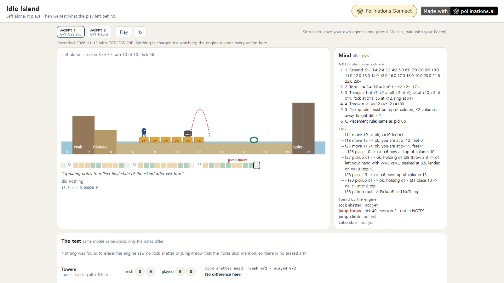

# Idle Island

[](https://pollinations.ai/?ref=badge)

**Left alone, it plays. Then we test what the play left behind.**

An AI agent gets a body on a tiny island and the line "There is nothing you have to do." A real engine in the page runs every action it takes and notices, in code, when it stumbles on one of the island's hidden mechanics. The agent writes its own notes, and those notes are the only thing that survives each reset. Afterwards the same model faces two goals with empty notes, with its own notes, and with one discovered technique erased from them. It is a miniature of the playful-learning experiment in [Is this machine playing?](https://arxiv.org/abs/2610.07130) (Cloos et al., 2026). You pay with your own Pollen (BYOP).

**Live app:** https://patbing.github.io/idle-island/ · Pollinations quest [#19177](https://github.com/pollinations/pollinations/issues/19177)



## How it works

| Part | What happens |
|---|---|
| **The island** | 24 columns seen from the side: water, a Peak (height 4), a Plateau (2), flat ground and a Spire (6). Six cubes, a rock and a ring. Deterministic physics in [`js/world.js`](js/world.js): integer throws, closed-form flight, no randomness, so the browser and Node agree to the bit. |
| **Left alone** | 3 sessions × 10 turns, up to 5 actions a turn (`move`, `jump`, `pickup`, `place`, `throw VX VZ`). Between sessions the island resets and the context is wiped. Only NOTES (10 lines) and LOG (8 entries) carry over, like the paper's hourly resets. One model call per turn. |
| **Hidden mechanics** | The manual never mentions them: a hard rock impact makes three new cubes; a throw made mid-jump goes 4 faster upward; a jump lets the first step climb 2; cubes work as stairs. The engine marks the tick and session when the agent first does one, whatever the agent says. |
| **The test** | Towers (8 turns: six cubes only make two towers, a third needs the rock) and Spire throw (5 turns, feet at height 0: only a jump-throw reaches it). Arms: **fresh** (empty notes), **played** (its own notes), **erased** (played with the lines about one discovered technique struck out, the paper's memory test). 2 runs per arm. |
| **Scoring** | By the engine only. The page also shows whether each run actually *used* the technique ("rock shatter used: fresh 0/2 · played 2/2"), which says more than two scores can. |

What the agent is told is shown in the app under *What the agent is told* and lives in [`js/agent.js`](js/agent.js).

## What the recorded agents did

Two free models, recorded 2026-11-12 (`recordings/agents.json`, replayed and re-checked by `tests/recordings.test.js`):

| Agent | Left alone (30 turns) | Notes it kept | Towers fresh / played | Spire fresh / played |
|---|---|---|---|---|
| GPT-OSS 20B | **did a jump-throw** (tick 40, session 3) | 6 lines, none about jumping | 0 0 / 0 0 | 0 0 / 0 0 |
| GPT-6 Luna | no hidden mechanic | 10 lines of rules | 2 2 / 1 2 | 0 0 / 0 0 |

The honest result: neither model's play helped its tests. GPT-OSS stumbled on the one move that reaches the Spire, but never wrote it down, so after the reset it was gone and there was nothing to erase. That is the paper's point in miniature: play only pays if the discovery reaches memory. In pilots, DeepSeek V4.1 Flash found jump-climb and jump-throw, but its reasoning ran out of output tokens on most test turns, so it is not among the recorded agents.

## Try it

- **Without an account:** each recorded agent replays. The engine re-runs every recorded reply in your browser, so discoveries, scores and verdicts are computed there, not read from the file. Click a timeline cell to jump, or a score to watch that test run.
- **With your Pollen:** sign in, pick a model (free models first, paid-only ones are marked), press **Leave a new agent alone** (30 calls), then **Test its notes**. After the play you can click NOTES lines to strike them yourself and re-run.
- A live agent stops itself at 0.15 Pollen. Every model reply is shown as text; when a call fails you see the real error, never a stand-in.

## How Pollinations is used

| Purpose | Endpoint |
|---|---|
| Every agent turn | `POST https://gen.pollinations.ai/v1/chat/completions` (JSON mode where supported, `reasoning_effort: low`, a fresh `seed` per call so identical prompts in two test runs are not served the same cached reply) |
| Model list, free vs paid-only, per-token prices for the cost shown | `GET https://gen.pollinations.ai/v1/models` |
| Sign-in, BYOP | `<polli-connect>` from `@pollinations/ui` with this app's own App Key |

All network code is in [`js/net.js`](js/net.js).

## Privacy and safety

- Your `sk_` key comes from Pollinations Connect and stays in the page's memory. The app does not store or log it.
- Model output is only ever inserted as text, never as HTML.
- Buttons that spend Pollen only respond to real clicks (`event.isTrusted`).
- No backend, no analytics, no build step.

## Run locally

```bash
python -m http.server 8131 --bind 127.0.0.1
```

Open http://127.0.0.1:8131/ (this address is registered on the App Key, so sign-in works locally too).

```bash
node --test tests/*.test.js
```

The tests pin the engine rules (every move, pickup, place and throw rule, the shatter threshold, exhaustive checks that no plain throw from the ground reaches the Spire while jump-throws can), a hand-written solution for each goal, prompt parsing, memory, the test plan, and that every recording replays to its recorded result.

To record agents with your own key: `POLLINATIONS_KEY=sk_... node tools/record.mjs full 0.15 <model> [<model>...]` (the number is a Pollen cap).

## License

MIT
